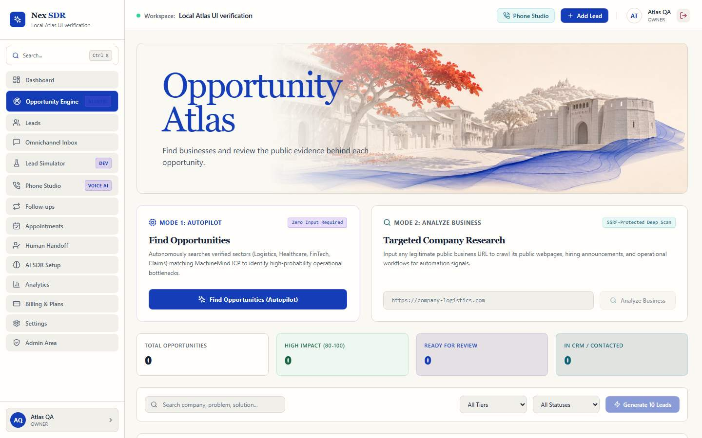

# NexSDR

**An India-first sales workspace for finding prospects, qualifying enquiries, and managing follow-ups.** A salon can give its AI receptionist a menu and bridal pricing. A real estate team can configure a property consultant with service areas, budget questions, and site-visit instructions. Both use the same CRM and can practise conversations in the browser.

[Open NexSDR](https://nexsdr.in) · [Explore Opportunity Atlas](https://nexsdr.in/opportunities) · [Run locally](#run-locally)



## Try it in three minutes

1. **Set up a business.** Choose **Create workspace**, select an industry, then open **Settings → Business profile**. Enter the services, location, pricing, and qualification questions the agent should use.
2. **Review a prospect.** In **Opportunity Engine**, enter a public company page under targeted research or run **Find opportunities**. Inspect the source and evidence before approving a result for the CRM. Businesses without enough public evidence may yield no qualified results. A business listing alone does not establish customer buying intent.
3. **Practise a conversation.** Add a test lead in **Leads**, select it in **Phone Studio**, allow microphone access, and start a simulation. For a salon, try *“I need bridal makeup in Pune next month. What does your package include?”* Ask a follow-up, then end the session and review the transcript and summary. Phone Studio uses browser audio and does not dial mobile numbers.

## What works in the project

| Area | Implementation |
| --- | --- |
| Discovery | Opportunity Atlas searches public sources or researches a supplied URL. The research trail records pages read, evidence, and qualification outcomes. |
| CRM | Create or import leads from CSV, inspect a lead’s history, track qualification, schedule follow-ups, and hand a conversation to a person. |
| Voice practice | Browser microphone, voice activity detection, speech recognition, contextual AI replies, audio playback, interruption handling, and a text fallback. Live AI responses depend on a working provider. |
| Email | Resend integration for configured outbound and inbound email, thread tracking, STOP/opt-out handling, and human takeover. Invalid AI email payloads are blocked before delivery. |
| Workspace dashboard | Lead and appointment counts, response rate, scheduled follow-ups, recent conversations, and activity from the workspace database. |

Browser calls are simulations. SMS and WhatsApp dispatch are mock channels in this version. Live email is a separate integration and needs sender configuration.

## Run locally

Use **Node.js 22 or 24**, npm, and a fresh local SQLite database. From the repository root:

Phone Studio uses the online Neerja Expressive voice. Install Python 3 with venv support or uv on the backend machine. The backend build provisions its speech runtime automatically. For local development, run `npm run voice:prepare -w apps/backend` once after installing dependencies. Use **Listen to Neerja** in Phone Studio to check synthesis and playback before starting a simulation.

```sh
git clone https://github.com/tanisharora2029-hub/SDR.git
cd SDR
npm ci
npm run build -w packages/shared
```

Create **`apps/backend/.env`** with the following development settings. Generate a signing secret with `node -e "console.log(require('crypto').randomBytes(48).toString('hex'))"` and paste the output in place of the placeholder.

```dotenv
NODE_ENV=development
PORT=5000
DATABASE_URL="file:./dev.db"
JWT_SECRET=replace-with-your-generated-secret
CORS_ORIGIN=http://localhost:3000
AI_PROVIDER=mock
EMAIL_PROVIDER=ETHEREAL
```

Leave `VITE_API_BASE_URL` unset for local development. Vite proxies `/api` and `/ws` to the backend. Initialise the **local** database and start both apps:

```sh
npm run prisma:push -w apps/backend
npm run dev
```

Open [localhost:3000](http://localhost:3000) and create a workspace. The [API health endpoint](http://localhost:5000/api/health) should report healthy. Seeding is optional. **The seed script deletes existing records before inserting demo data**, so use it only with a disposable database.

### Provider options

- **Offline walkthrough:** `AI_PROVIDER=mock` gives deterministic responses for exploring CRM workflows. It does not demonstrate live model reasoning.
- **Local inference:** Run Ollama, pull the model with `ollama pull qwen2.5:3b`, and set `AI_PROVIDER=ollama`, `OLLAMA_BASE_URL=http://localhost:11434`, and `OLLAMA_MODEL=qwen2.5:3b`.
- **Hosted inference:** Configure the backend with `AI_PROVIDER=groq` and `GROQ_API_KEY` for Groq. Voice routing has its own configuration. See the [provider implementations](apps/backend/src/services/ai) and [environment example](.env.example).
- **Live email:** Configure `EMAIL_PROVIDER=RESEND`, `RESEND_API_KEY`, and `RESEND_FROM_EMAIL` for a verified sender. Inbound webhook verification uses `RESEND_WEBHOOK_SECRET`. Keep provider keys in the backend environment.

## Architecture

| Directory | Responsibility |
| --- | --- |
| [apps/frontend](apps/frontend) | React, TypeScript, Vite, and Tailwind. The Atlas UI includes discovery, CRM, the inbox, and Phone Studio. |
| [apps/backend](apps/backend) | Express API, JWT authentication, workspace-scoped services, WebSocket updates, AI routing, and email integrations. |
| [apps/backend/prisma](apps/backend/prisma) | Prisma schema for organisations, users, leads, messages, research runs, appointments, and simulation sessions. Local development uses SQLite, with PostgreSQL support for hosted environments. |
| [packages/shared](packages/shared) | Shared TypeScript types, Zod validation schemas, industry configuration, and SDR tool definitions. |

## Verification

After local setup, run from the repository root against a **disposable local database**:

```sh
npm test
npm run build
```

The Atlas release passed **139 automated tests across 21 files** and the production build. Local Chrome checks opened all 19 routes and exercised mobile discovery layout and the Add Lead dialog. Microphone quality, hosted model availability, and real inbox delivery require live checks with the intended browser and provider accounts.

[Regression tests](apps/backend/src/tests) · [Implementation notes and remaining work](PHASE2_PROGRESS.md)
